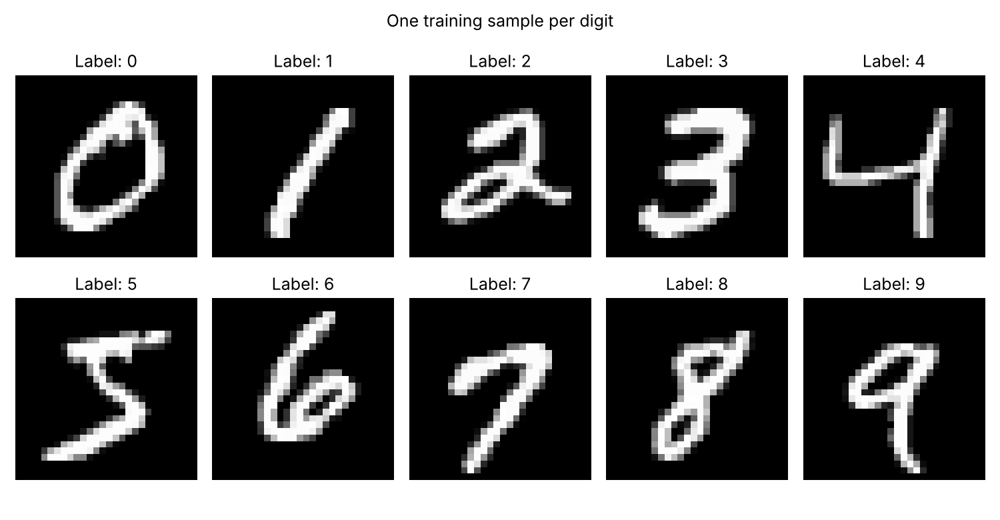

# Handwritten Digit Recognition (MNIST)

ICT 361 Introduction to Robotics, Assignment 1

For this assignment I took the Fashion-MNIST logistic regression example from class and changed it to recognize handwritten digits 0 to 9 using the MNIST dataset. Most of the code is the same, the main changes are the dataset, the class names, and some extra plots and a predict script.

## How to run

```bash
python -m venv .venv
source .venv/bin/activate          # on Windows: .venv\Scripts\activate
pip install -r requirements.txt

python data_prep.py    # download data, print shapes, save sample image
python train.py        # train and evaluate, saves everything in outputs/
python predict.py      # use the saved model to predict some test images
python predict.py my_digit.png   # try your own image (dark digit on white paper)
```

## Files

| File | What it does |
|------|---------|
| `data_prep.py` | Downloads MNIST from Kaggle, checks the data and scales the pixels |
| `model.py` | The model class. I put it in its own file so `predict.py` can use it without running training again |
| `train.py` | Trains the model, evaluates it, saves the plots and the model |
| `predict.py` | Loads the saved model and predicts, no retraining |
| `requirements.txt` | Packages needed |
| `outputs/` | Model file, results and figures |

---

## Part 1: Dataset and Preprocessing

Shapes from `outputs/dataset_summary.txt`:

```
X_train: (60000, 784)    y_train: (60000,)
X_test : (10000, 784)    y_test : (10000,)
```

One example of each digit from the training set:



**1. How many training and test images are there?**

There are 60,000 training images and 10,000 test images.

**2. What are the image dimensions and class labels?**

Every image is 28 x 28 pixels in grayscale. The labels are 0 to 9 and the label is just the digit itself, so label 3 means the picture is a 3. The classes are not exactly equal. In the training set there are 6,742 ones but only 5,421 fives.

**3. Why do we convert each image into 784 values?**

Because 28 x 28 = 784. Our model is only one linear layer and it needs a flat list of numbers as input, not a 2D image. So each pixel becomes one input. In this dataset the CSV is already stored that way, one row per image. One downside is the model doesn't know which pixels are next to each other anymore.

**4. Why do we divide pixel values by 255?**

Pixels go from 0 (black) to 255 (white). Dividing by 255 makes them between 0 and 1. Smaller numbers make training more stable because the weights and gradients don't get too big. We have to do the same thing to any new image we want to predict later.

**5. Why must training and test data remain separate?**

The test set is supposed to show how the model does on images it has never seen before. If we train on the test images too, the model can just remember them and the accuracy will look better than it really is. So I used the train/test split that came with the dataset and didn't mix them.

---

## Part 2: Model and Training

Model and settings (`outputs/model_and_settings.txt`):

```
MNISTLogisticRegression(
  (linear): Linear(in_features=784, out_features=10, bias=True)
)
Trainable parameters: 7850

Batch size   : 64
Learning rate: 0.0005
Epochs       : 40
Optimizer    : Adam (weight_decay=0.0001)
Loss         : CrossEntropyLoss
Seed         : 42
```

Training loss:


**1. Why does the model use 784 inputs and 10 outputs?**

784 inputs because there is one input for each pixel. 10 outputs because there are 10 digits, and each output is a score for one digit. Whichever digit has the highest score is the prediction. Each digit has 784 weights plus a bias, so in total there are 784 x 10 + 10 = 7,850 parameters.

**2. Why do we use `CrossEntropyLoss`?**

Because this is a classification problem with more than 2 classes and each image only has one right answer. Cross entropy turns the 10 scores into probabilities (with softmax) and gives a big loss when the probability for the correct digit is low. It works directly with the raw scores and the integer labels, so I didn't need to add softmax to the model or make one-hot labels.

**3. What batch size, learning rate, and number of epochs did you use?**

Batch size 64, learning rate 0.0005 with Adam (weight decay 0.0001), and 40 epochs. I kept the same settings as the Fashion-MNIST example so I could compare the two.

**4. How did the training loss change? What does this tell you?**

In the first epoch the loss was ‹FILL: epoch 1 from `outputs/training_losses.txt`› and by epoch 40 it was ‹FILL: epoch 40›. ‹FILL: what the curve looks like, e.g. "It dropped a lot in the first few epochs and then went down slowly."› This means the model was learning and getting better at giving the right digit a high probability. Since it flattens out near the end, I think training longer wouldn't help much because a linear model can only do so well. I only plotted training loss and didn't use a validation set, so this graph alone can't tell me if the model is overfitting.

---

## Part 3: Evaluation and Predictions

Results from `outputs/evaluation.txt`:

```
‹FILL: paste the whole outputs/evaluation.txt here›
```

Confusion matrix:


Nine random test images (green means correct, red means wrong):


Three wrong predictions:


‹FILL: a short note for each wrong image, e.g. "The first one is a 4 but the top is almost closed, so it looks like a 9."›

**1. What test accuracy did you achieve?**

I got ‹FILL›% accuracy on the test set (‹FILL› out of 10,000 correct).

**2. How does it compare with the most-frequent-class baseline?**

The baseline just predicts 1 for every image, because 1 is the most common digit in the training set. That's only right for the 1,135 test images that are actually 1, so it gets 11.35%. My model got ‹FILL›%, which is way higher, so it actually learned something from the pixels and isn't just guessing.

**3. Which digit has the highest recall? Which has the lowest?**

The highest recall was digit ‹FILL› (‹FILL›) and the lowest was digit ‹FILL› (‹FILL›). ‹FILL: your reason, e.g. "0 and 1 have simple shapes that are easy to tell apart, but 5 and 8 look similar to other digits."›

**4. Which digit pairs are frequently confused?**

Looking at the confusion matrix and the list at the bottom of `evaluation.txt`, the pairs that got mixed up the most were ‹FILL: e.g. 4 → 9 (count), 5 → 3 (count), 7 → 9 (count)›. ‹FILL: why, e.g. "4 and 9 look alike when the top of the 4 is closed."›

**5. What might explain the incorrect predictions?**

The biggest reason is that the model is linear. It basically learns one pixel pattern for each digit and checks how much the image matches it. It can't really understand shapes, so digits that use a lot of the same pixels, like 4 and 9 or 3, 5 and 8, get confused. It also doesn't handle digits that are shifted, tilted, or written thicker or thinner very well, because then different pixels light up. And some of the handwriting in the test set is just messy, I would have trouble reading a few of them myself. I also noticed that the model can be wrong and still be pretty confident about it.

**6. Does a high test accuracy guarantee correct predictions on camera images? Explain.**

No. The test images all look like MNIST: white digits on a black background, centered, and the same size. A photo from a camera is very different. It's usually dark ink on white paper (opposite colors), the lighting isn't even, there can be shadows and background, and the digit might not be in the middle. Since this model depends a lot on exact pixel positions, these differences could make the accuracy drop a lot. To use a camera image I would need to convert it to grayscale, crop and center the digit, resize to 28 x 28, invert the colors and divide by 255, and even then I'd have to test it on real photos to know. Also the model has no "not a digit" option, so it will always guess some number even if there's no digit in the picture.

---

## What I would try next

- Split off some training data as a validation set to tune the learning rate and check for overfitting.
- Try a CNN, which should handle shifted digits better than a single linear layer.
- Add small rotations and shifts to the training images (data augmentation), which might help with camera images.
